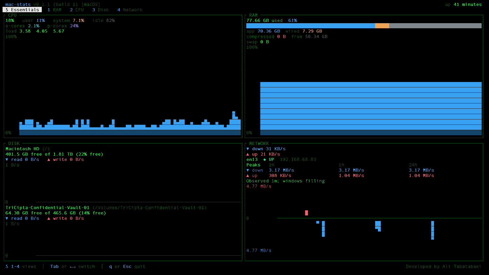
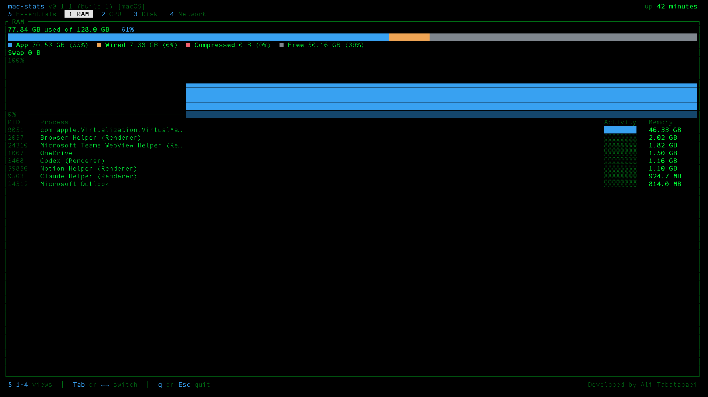
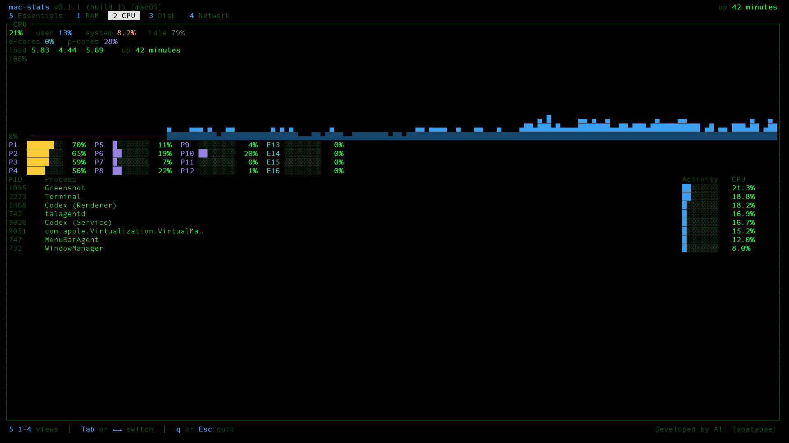
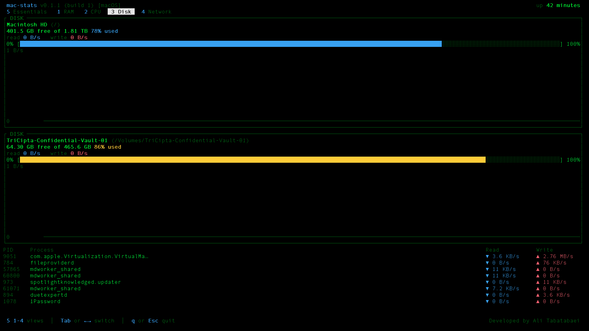
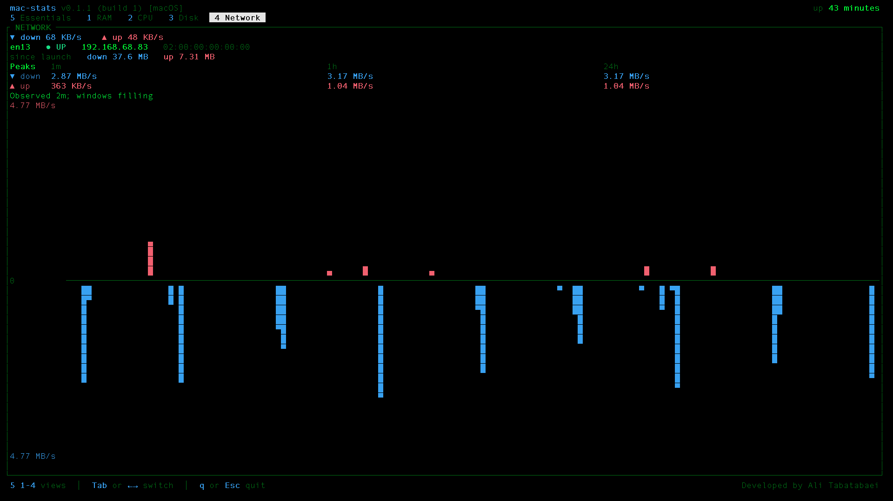

# mac-stats

Developed by **Ali Tabatabaei**.

A macOS terminal monitor for CPU, memory, disk, network, and AI subscription allowance. It is one local binary. System statistics stay local, with history kept in memory while the app runs. The optional AI view reads Codex account usage through your signed-in CLI and a local Claude Code usage feed.

The screen refreshes about once a second. Five system views share that sample, and a sixth view shows AI usage:

| Key | View | What it shows |
| --- | --- | --- |
| `5` | Essentials | The headline of each of the other four, with no process table |
| `1` | RAM | Used memory, the app / wired / compressed / free split, swap, history, top processes |
| `2` | CPU | Overall, user, system, and idle time, cores, load, uptime, history, top processes |
| `3` | Disk | Each user volume's free space and read/write rate, history, top processes |
| `4` | Network | The default interface, down and up rates, history, rolling peak rates, totals since launch |
| `6` | AI | Codex and Claude allowance remaining, reset countdowns, observation age, and available token usage |

Essentials uses a two-by-two layout when the content area is at least 88 columns by 16 rows. The title and the footer take three rows, so that is a terminal of about 88 by 19. Otherwise the four cards stack.

## Screenshots

The five system views, captured in version `0.1.1` (build `1`).

### Essentials (`5`)



### RAM (`1`)



### CPU (`2`)



### Disk (`3`)



### Network (`4`)



## Requirements

- macOS. The collectors read Mach, IOKit, and sysctl, and the crate does not build on other systems.
- A current stable Rust toolchain (`rustup` is the straightforward way to get one). The package uses the 2024 edition.
- A terminal at least 70 columns by 20 rows. A smaller window asks you to resize it.

## Run

From this directory:

```shell
cargo run
```

That opens the terminal UI on Essentials. A release build is the one to leave running:

```shell
cargo build --release
./target/release/mac-stats
```

Print one sample and exit. The program takes a first reading, waits one second, then prints the second, so the rates in that report are real:

```shell
cargo run -- --once
```

Show the key list:

```shell
cargo run -- --help
```

An unknown argument exits with status 2.

### Version and build number

The dashboard title, help, and one-sample report show the release version and build number, such as `mac-stats v0.2.0 (build 2)`. The dashboard footer and command help also show the developer credit.

Print the release identity without opening the monitor or sampling system counters:

```shell
cargo run -- --version
```

`-V` is an alias for `--version`. The version comes from `Cargo.toml`, the separate build counter from `BUILD_NUMBER`, and the developer credit from the package authors. These values are embedded when compiling.

When preparing each release, update the package version in `Cargo.toml` and increment `BUILD_NUMBER` (for example, `0.2.1` and `3` for the next patch release). Build and verify the release, then commit both files and the updated `Cargo.lock`. The counter must be a positive integer and stays the same when rebuilding the same release.

### Keys

| Key | Action |
| --- | --- |
| `5` `1` `2` `3` `4` `6` | Jump to a view |
| Tab, Right | Next view, in the order Essentials, RAM, CPU, Disk, Network, AI |
| Shift-Tab, Left | Previous view |
| `q`, Esc, Ctrl-C | Quit |

Rates show `…` until the second sample, then `—` when a counter is missing.

## AI allowance and usage

Press `6` for Codex and Claude subscription allowance. Each reported quota window shows its remaining percentage, a reset countdown, and the reset date and time in your local time zone. If the local time zone cannot be read, the date and time are explicitly labeled UTC.

Provider collection starts when you first select AI. Codex refreshes about once a minute in the background, with a ten-second timeout. The worker checks the Claude feed on a two-second interval between Codex queries. Collection continues while you switch between views and stops when you quit. mac-stats does not start AI inference or perform a new provider login.

Readings older than five minutes show `STALE`. A failed refresh preserves the last successful reading and its original observation time, with an explanatory status. Provider-reported reached-limit or restricted-usage status is shown alongside any remaining window allowance. Once a reported reset time has passed, the allowance shows `awaiting update` until the provider reports another reading. Missing quota or token data is shown as unavailable, rather than as a zero or full allowance.

### Codex

Install the Codex CLI and sign in to your ChatGPT account through Codex. mac-stats uses its documented [account interface](https://learn.chatgpt.com/docs/app-server), with the CLI handling existing authentication. An API-key-only login does not provide a ChatGPT subscription allowance. Quota window lengths come from the provider; the app does not assume every account has the same limits.

When available, the AI view also shows the account lifetime token count. This is an account summary, rather than the token count of a single session.

### Claude Code

The [Claude Code status-line feed](https://code.claude.com/docs/en/statusline#rate-limit-usage) exposes subscription quota for supported signed-in Pro and Max accounts after an API response. Set up the local feed once using the release binary:

```shell
./target/release/mac-stats --install-claude-feed
```

The command adds a status-line command to `~/.claude/settings.json`, or the settings directory specified by `CLAUDE_CONFIG_DIR`, preserving other settings. Repeating setup with the same executable is safe. An existing custom status line or symlinked settings file is preserved and requires manual configuration: in your current script, pipe the incoming JSON into `mac-stats --claude-statusline`, then keep your existing display output.

Restart Claude Code after setup. Its next response populates the usage feed. Quota is account allowance. The model name and estimated session API cost come from the most recently exported Claude Code session. Context token counts describe the latest context and response, including cached input, rather than cumulative session consumption. Claude Code computes the estimated API cost using its pricing settings; this is not a subscription bill. The exporter reads only status-line input and does not read Claude credentials or conversation transcripts.

The minimal snapshot is stored at `~/.local/share/mac-stats/claude-usage.json` with owner-only permissions and atomic replacement. Set `MAC_STATS_CLAUDE_USAGE_FILE` to use a different regular-file path in both mac-stats and Claude Code; named pipes and devices are rejected. The snapshot persists between runs; system graph history remains in memory. Freshness measures when the feed was exported, so a Claude status-line rerun is not proof of a new server quota query. To disable the feed, remove its `statusLine` entry from Claude settings.

### One-time AI report

```shell
./target/release/mac-stats --ai-once
```

This prints provider status, all reported windows, and available usage without opening the terminal UI. An unavailable provider is reported in the output; the command still exits successfully after completing the check. Grok, Alibaba, and Ollama integrations are not included in this release.

## What each view measures

**RAM.** Installed memory comes from `hw.memsize`. The split follows the same parts as the Stats menu-bar app: app, wired, compressed, and free. Those four add up to installed RAM. The bar and the history are percent of that total. Swap comes from `vm.swapusage`. The process list is the top 8 by resident memory. Resident size can differ from the physical footprint Activity Monitor shows.

**CPU.** Overall, user, system, and idle come from host CPU tick deltas. Nice time is counted as user. On Apple Silicon, efficiency and performance cores are labeled when the two performance levels add up to the core count. Per-core bars use the same tick counters. Load is the 1, 5, and 15 minute averages, and uptime is the system uptime. The process list is the top 8 by CPU. A process can read above 100% because that figure is one core, not the whole chip. Live GHz is not shown. The public sysctls report 0 on Apple Silicon.

**Disk.** Volumes are the startup disk (`/`) and anything mounted directly under `/Volumes`. Hidden system mounts such as `/System/Volumes/Data` are left out. Each card shows free space, a capacity gauge, and read/write throughput. Throughput comes from the IOKit block-storage counters for that volume's disk. Volumes on the same physical disk share those counters. The graph draws read (blue) and write (red) from the same baseline. The process list is the top 8 by disk IO since the last sample.

**Network.** The interface is the one used for the default route, found by matching a local UDP connect against the interface addresses. The card shows whether it is up, the local IPv4 address, the MAC address, and the current down and up rates. Download is blue and grows down from the center line. Upload is red and grows up from it. Both use one scale with a labeled zero center, so the same rate is the same height on either side. "Since launch" is the sum of samples taken while this process has been running, and it resets if the chosen interface changes. It is not the total since boot. Both Network and Essentials show the highest observed download and upload rates over the rolling past minute, hour, and 24 hours. These peaks use elapsed time and remain in memory independently of the graph history. They reset when the active interface changes or the app restarts. The observation-time note indicates that longer windows are still filling; the app cannot recover traffic from before it started.

**Essentials.** The same four headlines in one screen: CPU percent and history, the memory split, mounted user volumes, and the default interface. The Disk card lists each volume with free space and read/write rates, adding per-volume history when space allows. Smaller cards use compact summaries and show how many additional volumes are available in the Disk view. There is no process table on this view.

## Graphs

Graph history is kept in memory for about 10 minutes (600 one-second samples). Nothing is written to disk.

Each sample is one column, with the newest column on the right. A short trace stays on the right instead of being stretched across the window. CPU and memory use a fixed 0–100% axis. Disk and network use a 1-2-5 axis that rises as soon as traffic crosses the next step and steps back down slowly after a spike has left the history, so a bar keeps its height while it scrolls left.

## Not in this version

Temperature, the memory-pressure gauge, live clock speed, ping latency and jitter, and per-process network rates are left out. The numbers above are the ones macOS exposes directly.

## Develop

```shell
cargo test
cargo clippy --all-targets -- -D warnings
```

`cargo test` includes a live sample of this Mac. The UI tests render the six views without opening a terminal. AI tests use synthetic account replies and temporary local feeds; they do not query your provider accounts.
